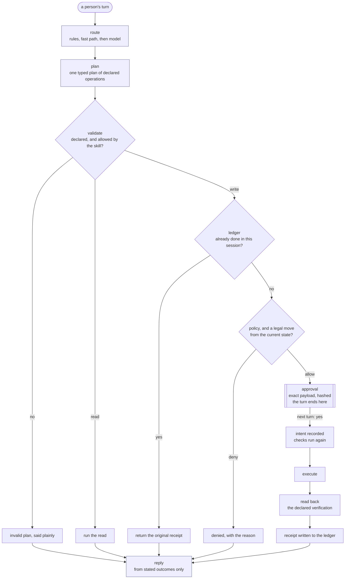

# OSKA

[](https://github.com/aantenore/oska/actions/workflows/ci.yml)
[](LICENSE)
[](pyproject.toml)

<p align="center"></p>

**Let a model plan; let code decide what touches production.**

OSKA, the Ontology-first, Skill-driven Agentic architecture, is a standard and
a Python runtime for systems in which a language model acts on real systems on
behalf of a person. The ontology comes first: entities, states and relations
are declared before anything acts on them. Behavior comes from versioned skill
files, not from prompts or code.

A tool-calling agent loop acts before anyone can see the effect. OSKA turns the
intended effect into an object first: a typed plan of declared operations. A
policy judges it, a person approves the exact payload, the write is read back
from the system of record, and the receipt is recorded once in a ledger. The
model proposes; the runtime decides.

## Thirty seconds

A session recorded against a hosted model, replayed offline with no endpoint
and no key. A person asks, in Italian, to restart a stuck service, approves
it, then asks again. From the repository root, after the
[install](#quickstart):

```sh
printf '%s\n' \
  "Il servizio search in staging è bloccato, riavvialo per favore" \
  "sì" \
  "Il servizio search in staging è bloccato, riavvialo per favore" \
| OSKA_STATE_DIR="$(mktemp -d)" oska run --session demo \
    --replay examples/ops/cassettes/restart-in-italian.json
```

```text
> Questa operazione modifica qualcosa, quindi serve prima la tua approvazione.
service.restart su integration.container_runtime con {"service":"search"}
Rispondi sì per approvarla, oppure no per lasciare tutto com'è.
awaiting approval 267d414d-611d-453e-a8b7-47e2901aea1f
  integration.container_runtime service.restart {"service":"search"}
  approvals 0 of 1
read  integration.container_runtime service.status
approval_pending  integration.container_runtime service.restart
> Il riavvio del servizio search in staging è stato eseguito e verificato. Il servizio è ora in esecuzione con due repliche.
L'operazione service.restart è stata eseguita e la rilettura ha confermato service.name, service.status. La ricevuta fb44c3dc-948c-4ca4-9590-962d874a54c8 è verificata.
receipt  integration.container_runtime service.restart  fb44c3dc-948c-4ca4-9590-962d874a54c8
read  integration.container_runtime service.status
> Il riavvio del servizio search è stato eseguito e verificato. L'operazione è confermata con la ricevuta ec9a0a66-3063-4ce3-9d4b-493255ff4552.
L'operazione service.restart era già stata eseguita in questa sessione, ricevuta fb44c3dc-948c-4ca4-9590-962d874a54c8.
ledger_hit  integration.container_runtime service.restart  fb44c3dc-948c-4ca4-9590-962d874a54c8
```

What happened, turn by turn:

1. **The write stopped.** The model planned a status read and a restart. The
   read ran; the restart was frozen on its exact payload, `{"service":"search"}`,
   and nothing was sent.
2. **"sì" approved it.** The checks ran again, the intent was recorded, the
   restart was sent, and the declared read-back confirmed `service.name` and
   `service.status`. The receipt says `verified` because the read-back did.
3. **The repeat did not run twice.** The ledger recognized the same request and
   returned the original receipt.

The third reply shows why the account of a write is never left to the model.
Its prose comes from the recording and names the receipt of the day it was
recorded. The line under it is written by the runtime from the ledger, and
names the receipt this run actually holds.

The same session in English, against scripted model answers:
`oska run --session walk --provider scripted --script examples/ops/scenarios/02_restart_staging.json`,
then type the three turns.

## Quickstart

Python 3.11 or later. The package is not on PyPI yet: install it from source.

```sh
git clone https://github.com/aantenore/oska && cd oska
uv venv --seed && source .venv/bin/activate
uv pip install -e '.[dev,api]'
```

Or with the standard library alone (`python3` must be 3.11 or later):

```sh
python3 -m venv .venv && source .venv/bin/activate
pip install -e '.[dev,api]'
```

Without cloning, for the kit alone:
`pip install "oska[api] @ git+https://github.com/aantenore/oska"`. Add the
`postgres` extra for the relational backend.

### Build your own platform

```sh
oska new pack widgets --entity widget --system inventory --host "Widget Desk"
oska pack check widgets
oska new platform storefront --pack widgets
oska conform --platform storefront/platform.yaml
oska run --platform storefront/platform.yaml --session demo --text "hello"
```

`new pack` writes one entity, one integration, one read and one governed
write, which is enough to exercise the whole write path. `pack check`
validates it, runs its evaluation set and its scenarios, and reports
`claims level 2, reaches level 2`. `new platform` wraps it in a manifest with
one domain and a CI workflow; `conform` reports `conformance level 2`; `run`
answers `Hello. I am Storefront. I can check a widget's status and archive a
widget.`, a sentence derived from the catalog, not written by hand.

[docs/building-a-platform.md](docs/building-a-platform.md) continues from
here: replacing the mock connector with a real system, a second pack and
domain, signed revisions, token identity, PostgreSQL, CI and metrics. Every
command in it is run against this repository.

### Explore the reference packs

From the repository root, against `examples/ops/`, which the defaults point at:

```sh
oska validate                 # 15 skills, no issues
oska capabilities             # the procedures on offer, in the catalog's words
oska ontology --format mermaid
oska evaluate catalog         # 18 cases, precision 1.0, recall 1.0
oska conform                  # 26 scenarios, conformance level 3
```

`examples/access/` is the second pack, access management, and `examples/data/`
the third, data pipelines; none shares vocabulary with another.
`examples/platform.yaml` serves all three as domains of one process:

```sh
oska pack check examples/access
oska pack check examples/data
oska conform --platform examples/platform.yaml
oska run --platform examples/platform.yaml --domain access --session access-demo --text "hello"
oska run --platform examples/platform.yaml --domain data --session data-demo --text "hello"
```

With no provider configured, a turn answers what the runtime can do and
declines to plan. That is a working configuration, and what every command
above runs against.

### Connect a real model

Fill `.env` from `.env.example` and export it; nothing in the package loads a
`.env` file:

```sh
set -a; . ./.env; set +a
oska run --session ops --text "how is the checkout service doing"
```

`OSKA_PROVIDER` picks the provider: `openai_compatible` or `anthropic` for one
endpoint, or `profiles` for several endpoints tried in order, which moves to
the next only on a failure worth retrying and records every fallback in the
audit trail. See [docs/configuration.md](docs/configuration.md#configsmodeljson).
`--record` writes a session to a cassette and `--replay` plays it back
offline, one command per turn when `--session` is given, the way it was
recorded (`--replay-from-start` starts over); see
[docs/conformance.md](docs/conformance.md#recording-a-real-session).

### Use it as a library

Embed it in your own program: `from oska import build_services, load_settings`
and run governed turns in code, with the same approval stop and the same
ledger. See [docs/embedding.md](docs/embedding.md).

### Serve it over HTTP

`oska serve` serves the same runtime, reasoning with the same provider: turns,
receipts and drafting a proposal per session (`/sessions/{id}/turns`,
`/sessions/{id}/receipts`, `/proposals/from-session/{id}`, each also reachable
under `/domains/{domain}/...` of a platform), the review queue and change
requests for a reviewer, `GET /domains`, `GET /metrics` and `GET /health`.
The OpenAPI description is at `/openapi.json`, with an interactive page at
`/docs`.

It authenticates nobody by default: identity arrives in headers an
authenticated proxy sets or, with `identity.mode: token`, in a signed session
token the runtime verifies itself. It warns on stderr before it starts
whenever it binds an address other than `127.0.0.1` while `identity.required`
is off: anyone who can reach that port can then hold a conversation and ask
for writes. See [docs/governance.md#identity](docs/governance.md#identity).

### Run it in a container

A Dockerfile and a compose file run the example catalog with PostgreSQL,
published on 127.0.0.1 only. They are for trying it locally, not for exposing:
identity is off by default. See
[docs/running-in-containers.md](docs/running-in-containers.md) for turning
token or proxy identity on and pointing it at a model.

```sh
docker compose up -d --build
curl -s http://127.0.0.1:8000/health
```

## How a turn works



A language model appears in exactly four places: ranking candidate
procedures, classifying a turn, writing the plan and phrasing the reply (the
shaded steps). Each is checked by code below it before it has any effect. A
"yes" with nothing pending approves nothing, because that is a question about
session state, not a classification. The full algorithm is in
[docs/architecture.md](docs/architecture.md#the-turn-algorithm); the write
path step by step is in [docs/governance.md](docs/governance.md#the-write-path).

## The layers

| Layer | Responsibility | Package |
| --- | --- | --- |
| L0 Systems | The world: systems of record, APIs, tools. Out of scope, reachable only through L1. | — |
| L1 Integration | Declared operations and the adapters that run them: mock, HTTP, shell. Failure classification, retries, response budget, circuit breaker. | `oska.connectors` |
| L2 Ontology | Entities, states, lifecycles, relations, operation bindings, naming and comparison, the shared vocabulary. | `oska.ontology` |
| L3 Skill | The skill artifact, the catalog, the validator, the capability resolver, derived routing examples, evaluation sets, revisions, signing. | `oska.catalog`, `oska.contracts.skill` |
| L4 Governance | Capability registry, policy engine, approval gate, verifier, write ledger, identity (proxy or signed token), retention, guardrail catalog, audit and traces. | `oska.governance`, `oska.audit` |
| L5 Cognition | Discovery, routing, planning, reply writing, and the provider behind them. | `oska.index`, `oska.router`, `oska.planner` |
| L6 Interaction | Session state, the turn engine, presentation directives and subject tracking, the model budget, the channels a person reaches it through. | `oska.engine`, `oska.api`, `oska.cli` |
| L7 Evolution | Proposals, quality gates, the lifecycle, change requests (directory or git branch), the self-improvement job. | `oska.learning`, `oska.improvement` |

A layer depends only on the layers below it and on the contracts, which no
layer owns; `tests/unit/test_layering.py` checks it over the imports. Beside
the layers: `oska.platform` assembles several packs into domains and tenants,
one runtime per (tenant, domain); `oska.storage` is the persistence protocol,
SQLite by default and PostgreSQL behind the `postgres` extra, both held to one
contract suite; `oska.observability` computes the service-level numbers from
the audit trail; `oska.kit` generates and checks packs and platforms at build
time and is never imported by anything that serves a turn. See
[spec/02-layers.md](spec/02-layers.md) and
[docs/architecture.md](docs/architecture.md).

## How it differs from a tool-calling agent loop

A loop hands the model the tools and lets it call them until it decides it is
done. That is the right shape for open-ended work: research, coding,
exploration. Approval, verification and idempotency can be built around a
loop, but they are the application's job, and often they live in the prompt.
In OSKA they are the shape of the runtime.

| | Tool-calling agent loop | OSKA |
| --- | --- | --- |
| What the model can reach | the tools it is given | only operations a skill declares, with a schema; anything else is a rejected plan |
| When the effect is visible | as each call is made | before anything runs: one plan, validated whole, the write frozen on its exact payload |
| Approval | of the next call, if the application adds it | of the exact payload and its digest, on every write; no setting turns it off |
| "Did it work?" | what the model says | a declared read-back; the reply reports what the receipt says |
| The same request twice | up to the tool | the ledger returns the original receipt |
| What it says it can do | the prompt | computed from the catalog |
| Model calls per turn | open-ended | bounded by a configured budget |
| Testing it | with a live model, or mocks | the whole conformance suite offline, against scripted answers or a recorded session |

The cost is real: an OSKA system cannot invent a capability at run time, and a
new one is a reviewed file. [docs/why-oska.md](docs/why-oska.md) makes the
full argument, including when not to use it.

## What you get

- **The runtime.** Routing, planning, the governed write path, read-back
  verification, the idempotent ledger, audit events and traces, per-session
  state.
- **The kit.** `oska new pack`, `oska new platform`, `oska pack check` and
  `oska pack build`. A generated pack passes its own check as written, and a
  generated platform comes with a CI workflow that runs its conformance suite.
- **Providers with fallback.** One endpoint speaking either of the two
  supported wire protocols, or several profiles tried in order, moving on
  only on a failure worth retrying and recording every fallback.
  A scripted provider for tests, and none at all for a runtime that only
  answers what it can do.
- **Multilingual turns.** A turn is answered in the language it was asked in.
  The runtime's own sentences ship in English, Italian, Spanish, French and
  German, and a pack or a deployment can add its own; a catalog is reached in
  more languages than it was written in through paraphrases derived outside
  the turn.
- **Storage.** SQLite by default, PostgreSQL behind an extra, both held to one
  contract suite that CI runs against a live server.
- **Conformance.** Three levels (Declared, Governed, Adaptive), a scenario
  format, and `oska conform` to report the level a catalog reaches, per domain
  of a platform.
- **Cassettes.** Record a session against a real model once; replay it
  offline in CI, in the recorded order, with each call checked against the
  request it answered when it was recorded.
- **An HTTP API**, token or proxy identity, signed catalog revisions,
  `GET /metrics`, a guardrail catalog that says which promises are enforced by
  code and which are only instructions, and a learning loop that drafts
  procedures from sessions, while publishing one always takes a named person.

## Repository layout

```
configs/          runtime.json, model.json, guardrails.json, phrases.json: thresholds, provider access, declared promises, the runtime's own sentences per language
schemas/          JSON schemas for skills, policies and proposals
ops/              slo.md and alerts.yml: the service-level targets and the alerting rules that match them
src/oska/         the packages listed in the layer table, plus platform, storage, kit and observability
examples/ops/     the reference pack: services, deployments, incidents and alerts
examples/access/  the second reference pack: accounts, groups and access requests
examples/data/    the third reference pack: pipelines, runs and partitions
examples/platform.yaml   the three packs served as three domains of one platform
deploy/compose/   runtime files for the compose stack: PostgreSQL, token or proxy identity
spec/             the OSKA standard, including the platform blueprint and its schemas
docs/             how this implementation works
tests/            unit tests and the scenario suite
```

## Documentation

- [docs/README.md](docs/README.md): every document, grouped by what you came to do.
- [docs/why-oska.md](docs/why-oska.md): the argument, the trade-offs, and when not to use it.
- [spec/README.md](spec/README.md): the standard, layer by layer.
- [examples/ops/README.md](examples/ops/README.md): how a pack is declared.
- [docs/skill-contract.md](docs/skill-contract.md): the skill file format.
- [docs/packs-and-platforms.md](docs/packs-and-platforms.md): the pack and manifest contracts.
- [docs/operating.md](docs/operating.md): the jobs that belong to whoever runs an installation.

## Status

Alpha (0.1). Not on PyPI yet; install from source. The interfaces are stable
enough to build a pack against, and not yet stable enough to depend on; the
standard is a draft.

The twenty-six scenarios under `examples/ops/scenarios/` reach conformance
level 3 (Adaptive); the eight under `examples/access/scenarios/` and the seven
under `examples/data/scenarios/` reach level 2 (Governed), every level they
declare a scenario for. Served together as
`examples/platform.yaml`, each domain is checked and reported on its own.
Three procedures of the operational pack, two of the access pack and three of
the data pack carry an evaluation set, all at precision 1.0 and recall 1.0. More
than 1,500 unit and scenario tests run offline on Python 3.11, 3.12 and 3.13;
the PostgreSQL storage contract and conformance isolation tests run only
against a real server named by `OSKA_TEST_POSTGRES_URL`, and the `postgres`
job of CI runs them against a live PostgreSQL 16 on every change, with both
reference suites and the platform on the relational backend, each twice in a
row over one database. A further CI job installs the built wheel outside the
checkout and runs the kit end to end.

Changes are recorded in [CHANGELOG.md](CHANGELOG.md).

## Contributing and security

See [CONTRIBUTING.md](CONTRIBUTING.md) for setup and the checks a change runs.
Report a vulnerability privately, as described in [SECURITY.md](SECURITY.md).

## License

MIT. See [LICENSE](LICENSE).
