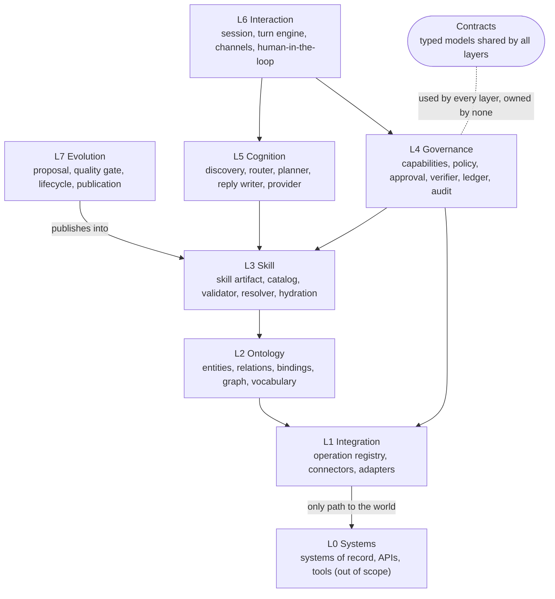

# 02 Layers

OSKA has eight layers. L0 is the world and is out of scope. L1 to L7 are the
system. Contracts are a shared vocabulary of typed models, owned by no layer.

## The model

Read an arrow as "depends on". The diagram draws the dependencies that carry
the design; the rule itself is about direction. A layer may use any layer below
it and the contracts. A layer MUST NOT import from a layer above it. In the
reference implementation `tests/unit/test_layering.py` checks that over the
package imports. Governance is worth spelling out: it reaches the integration
layer through a connector protocol it declares itself, so what it depends on is
the shape of a connector rather than any particular adapter.

## The layers

**L0 Systems.** Systems of record, APIs, command-line tools, queues,
infrastructure. Out of scope for this specification. Reachable only through L1.

**L1 Integration.** The declared operations and the adapters that run them. An
operation carries a name, a read or write flag, an input schema, an output
schema, an entity binding, a verification declaration for writes, and the
payload fields that form its idempotency key. See
[03-integration-layer.md](03-integration-layer.md).

**L2 Ontology.** Entity types with fields, identifier and states; typed
relations; the binding of operations to entity types; the lifecycle, which
declares the legal moves between states and the read the current state is taken
from; the graph that answers structural questions; the shared vocabulary. The
state of an object is read from the system of record through that declared
read, and is never inferred from the conversation or from what a write replied.
See [04-ontology-layer.md](04-ontology-layer.md).

**L3 Skill.** The skill artifact and everything that reads it: the catalog
with versioned roots and fingerprint reload, the validator, the capability
resolver that derives what the system says about itself, and hydration, which
resolves a procedure to its dependency closure. See
[05-skill-layer.md](05-skill-layer.md).

**L4 Governance.** The write path: capability registry, policy engine, approval
gate, verifier, write ledger and audit. Also the guardrail catalog: every
promise the installation makes about its own behavior, declared once with the
point at which it acts and the mechanism that keeps it — code the chain runs
and that can refuse, an invariant a named module keeps where the chain runs
nothing, or text handed to a model. The catalog is what says which of the
three a promise is; neither the skill that references it nor the prompt that
carries it may claim otherwise. See [06-governance-layer.md](06-governance-layer.md).

**L5 Cognition.** Everything a model touches: semantic discovery over the
catalog, the turn router, the planner that emits a typed plan, the reply
writer, and the provider interface behind all of them. See
[07-cognition-layer.md](07-cognition-layer.md).

**L6 Interaction.** Session state, the turn engine that runs the algorithm,
channels, and the human-in-the-loop points: questions for missing inputs,
approvals, cancellations. See [08-interaction-layer.md](08-interaction-layer.md).

**L7 Evolution.** Proposals, quality gates, the lifecycle with named actors,
and publication into a catalog root. Also the autonomy ladder: a system that
learns from its own traffic declares the rung it stands on, and every rung
above it is closed by a code path rather than by intent. The top rung —
publishing a capability — is never automatic. See
[09-evolution-layer.md](09-evolution-layer.md).

## The dependency rule

A layer MUST depend only on the layers below it and on contracts.

Three consequences carry the weight:

1. **L5 never calls L1.** Cognition does not execute anything. It emits a plan.
   L6 executes that plan through L4, which reaches L1. A component that both
   decides and acts has no place to put an approval.
2. **L7 writes only into L3.** Evolution publishes a skill file into a
   catalog root. It does not touch governance, sessions, connectors or the
   ledger. A learned procedure is a file, and it is governed like any other.
3. **Contracts are owned by nobody.** Typed models are shared by every layer
   and declared in one place. A module that needs a type another module already
   has does not import that module; both import the contract.

## What crosses a layer boundary

Only typed contracts. In particular:

- L5 hands L6 a plan of declared operations, never a connector call.
- L6 hands L4 one operation at a time, never a whole plan to execute freely.
- L4 hands L1 an operation name and a validated payload, never free text.
- L3 hands L5 a hydrated closure: the procedure text plus the entities and
  operations it may use. It does not hand over the whole catalog.

## Where a language model is allowed to appear

Exactly four places, all in L5: ranking candidate procedures, classifying a
turn, producing a plan, and phrasing a reply. Each of the four is validated by a
layer below it before it has any effect:

| Model act | Validated by |
| --- | --- |
| Ranking / tie break | L3 catalog membership |
| Turn classification | L6 session state (a claimed approval with nothing pending is not an approval) |
| Plan | L3 declarations plus the operation input schemas |
| Reply | L6 outcome list; only stated outcomes and catalog-derived suggestions |

No other layer may call a model provider. A system that consults a model inside
the policy engine, the verifier or the ledger does not conform.

None of the four is added to by a feature. Work that needs a model but is not
one of those four — deriving routing examples from declared triggers, say —
runs at publish time or in a scheduled job, and a turn reads what it wrote. A
turn spends no more model calls than the configured budget allows; see
[10-cross-cutting.md](10-cross-cutting.md), `OSKA-XC-13`.

## Requirements

The dependency rule is checked as a cross-cutting requirement; see
[10-cross-cutting.md](10-cross-cutting.md), `OSKA-XC-1` and `OSKA-XC-2`.
