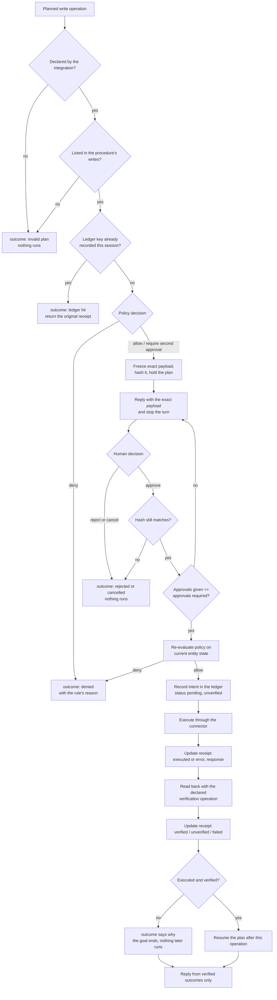

# 06 Governance layer (L4)

## Purpose

L4 is the boundary between a decision and an effect. Reads cross it on their
declaration alone. Writes cross it only after a fixed sequence of checks, and
only with a receipt on the other side.

The layer exists so that the answer to "could this system have done X without
anyone knowing" is structural rather than procedural. There is one path from a
plan to a write, it performs these steps in this order, and no configuration
shortens it.

## The write path

The steps and their order belong to this layer. Running them does not. The
sequence is driven by the interaction layer, which holds the turn, the session
and the plan the write sits inside; in the reference implementation that driver
is `src/oska/engine/execution.py`, with the second policy evaluation, the
approval arithmetic and the decision to go on past the write in
`src/oska/engine/approvals.py`, and the claim, the send and the read-back in
`src/oska/engine/settlement.py`. Governance decides what
each step answers; interaction decides when each step is reached. An
implementation MAY place the driver elsewhere, and MUST NOT let it reorder the
path or skip a step.



Every box on that path emits an audit event.

## Modules

### Capability Registry

Responsibility: answer whether an operation is declared, whether it writes, and
whether the procedure that planned it is allowed to perform it.

```text
CapabilityRegistry:
  operation_spec(integration_id, operation) -> OperationSpec | null
  is_declared(integration_id, operation) -> boolean
  is_write(integration_id, operation) -> boolean
  writes_allowed_by(procedure, operation) -> boolean
```

### Policy Engine

Responsibility: decide what happens to one write, given the payload and the
entity records the plan has already read.

A policy document belongs to one procedure and holds ordered rules. The first
matching rule decides. No matching rule denies. No policy at all denies. Reads
are not subject to policy; they are gated by declaration alone.

```text
PolicyRule:
  operation: string | "*"
  effect: allow | deny | require_second_approval
  when: map<dotted-path, {operator: value}>   # eq ne in not_in lt lte gt gte
  max_per_session: integer | null
  reason: string

PolicyEngine:
  evaluate(procedure, operation, payload, entities, session_id) -> PolicyDecision
```

Condition paths resolve against a merged view of the payload and the entity
records read in this turn, so a rule may say "not in production" by naming a
field of the entity rather than a field the model supplied.

The second evaluation, after the approval, is judged on state read again: every
read the plan performed before the write is performed again, not only the ones
a rule names. When any of them does not come back, the state is not confirmed
and the write is not sent; the outcome is `unavailable` and says so, because a
policy judging without that state would silently stop matching the rules
conditioned on it.

### Approval Gate

Responsibility: freeze exactly what will be sent, and hold it until a human
decides.

```text
PendingApproval:
  approval_id, procedure_id, plan, op_index
  integration_id, operation
  exact_payload: object
  payload_hash: string        # over a canonical serialization
  approvals_required: integer
  approvals_given: integer
  summary: string             # includes the exact payload

ApprovalGate:
  request(session, operation, payload) -> PendingApproval
  check(pending, payload) -> boolean
```

The hash is taken at request time and is independent of key order. Any change
to the payload produces a different hash and therefore requires a new request.
`check` is run twice before the write goes out: once against the payload the
held plan carries for the approved operation, and once against the frozen copy.
Comparing the frozen copy with itself would prove nothing, so the plan is the
other side of the comparison.

### Verifier

Responsibility: decide whether a write actually happened, by reading it back
through the operation the integration declared.

```text
Verifier:
  verify(spec, write_payload, connector) -> (status, evidence)
```

The read-back payload is built from the write payload, keeping only the fields
the read operation's input schema accepts. Each `expect` entry resolves either
to a literal or to a field of the write payload, and is compared against the
read-back result by dotted path. The status is `verified` only when the
read-back succeeded and every expectation held; otherwise `failed`, or
`unverified` when no read-back could run at all. The evidence is stored on the
receipt.

The entity the operation is bound to takes part in the comparison. When that
entity declares a state field and the closed set of states it may hold, a
declared transition supplies the expected value for that field unless the
`expect` block already names it, and a read-back that returns a value outside
the declared set is a failure whatever the other expectations said. See
[04-ontology-layer.md](04-ontology-layer.md).

The read-back is also run for a write that did not report success, whenever the
failure is one that could be sitting on top of a write the system applied. A
system that answered no is not read back — it answered. A write whose answer
never came is, because the failure says nothing about what the system did with
it. In that case a read-back that could not be performed is `unverified` and
not `failed`: a comparison nobody could make is not a contradiction, and the
difference decides whether the write may be sent again.

### Write Ledger

Responsibility: make a write recoverable and non-repeating.

```text
WriteReceipt:
  receipt_id, session_id, ledger_key
  integration_id, operation, payload
  response: object | null
  status: pending | executed | error
  verification: verified | unverified | failed
  verification_evidence: object | null
  created_at, error
  classification: retryable | ambiguous | terminal | null

WriteLedger:                       # LedgerStore
  key(integration_id, operation, payload, idempotency_fields) -> string
  new_receipt(session_id, key, integration_id, operation, payload) -> WriteReceipt
  record(receipt) -> WriteReceipt
  claim(receipt) -> WriteReceipt   # the receipt that holds the intent
  update(receipt_id, ...) -> WriteReceipt
  get(receipt_id) -> WriteReceipt | null
  lookup(session_id, key) -> WriteReceipt | null
  settled(session_id, key) -> WriteReceipt | null
  count(session_id, operation) -> integer
  for_session(session_id) -> [WriteReceipt]
  delete_session(session_id) -> integer
  sessions() -> [string]

SessionStateStore:
  load(session_id) -> SessionState
  save(state)
  sessions() -> [string]
  updated_at(session_id) -> datetime | null
  expired(before) -> [string]
  delete(session_id) -> integer
```

The ledger and the session store are interfaces, and where they are kept is
configuration: `storage.backend` names the backend and `storage.url_env` names
the environment variable a networked backend reads its address from. An
address is never written into a configuration file, because it usually carries
a credential, and a backend that needs one and finds none refuses to open,
naming the variable to set. A single process on its own disk keeps both in
SQLite files; several processes serving one deployment keep them in a shared
relational database. One behavioral contract is run against every backend, and
retention (below, and in 10) reaches the stores through the same interfaces.

A shared database may hold the state of several (tenant, domain) pairs of one
platform (see [14-platform-blueprint.md](14-platform-blueprint.md)). On disk
each pair has a directory of its own; in a shared database each has a
namespace, derived from the pair, and every session, receipt and write claim is
keyed by it. A query that is not restricted to its namespace is the one
forgotten column that lets one tenant read another's receipts, so the
restriction belongs to the store and not to its caller. Rows written before
namespaces existed belong to the default namespace.

The intent is taken with `claim`, not merely recorded. `claim` records the
receipt only when nothing settles its key, and the check and the record are one
atomic step for every thread and every process sharing the ledger: SQLite takes
the write lock of the file for it, and a relational backend inserts a claim row
with `ON CONFLICT DO NOTHING` and locks it with `SELECT ... FOR UPDATE` before
reading the receipts. Of two turns approving the same write at once, one sends
it and the other reports the receipt of the first.

The intent is recorded before the connector is called, with status `pending`.
A write whose outcome is unknown — the call was made and the answer did not
come, or the read-back did not confirm — stays in the ledger and blocks a
second attempt on the same key. `count` counts every receipt regardless of
status, so a failed attempt still consumes a session limit.

The classification on the receipt decides one thing: whether the key is
settled. It starts as the connector reported it (03, Availability) and, for an
`ambiguous` write, ends as the read-back settles it.

- **terminal.** The system answered, and the answer was no. The key is closed
  for the session exactly as an executed write closes it: `settled` returns the
  receipt and the write is not sent again.
- **retryable.** The key is open: `settled` returns nothing and the same intent
  may be asked for again in the session. The receipt of the attempt is not
  removed — what was tried is part of the account — and the next attempt writes
  a receipt of its own. A write is left `retryable` when its request provably
  never left, or when its read-back settled it that way.
- **ambiguous.** The request left and no usable answer came back. The key is
  closed until the read-back settles the write, and stays closed if the process
  never gets that far.
- **nothing recorded yet.** A receipt still `pending` settles the key. The
  intent was recorded before the call and the outcome is not known, which is
  the case the ledger exists for.

What must not be read into that table is that every transport failure means
the write never left. It does not. A read that timed out and a gateway
answering 502 can both be sitting on top of a write the system has already
applied, and settling such a write as "never sent" would send it again on the
next request, which is precisely the double write the ledger exists to prevent.
That is why the connector says which of the two it saw: `retryable` only where
the request provably never left, `ambiguous` wherever it left or may have.

A `retryable` write needs nothing more: nothing can have changed over there, so
it is not read back and its key stays open. An `ambiguous` write is settled by
what the declared read-back establishes about it:

- **The read-back answered and found the write in the system.** It landed. The
  receipt becomes an executed, verified write and the key is closed.
- **The read-back answered and contradicted the write.** It did not land.
  Nothing changed over there, the receipt becomes `error` and `retryable`, and
  the same intent may be asked for again.
- **The read-back did not answer.** Nothing is known. The key is closed unless
  the system of record would itself stop a second send — because the operation
  declares the idempotency fields that make two requests one request there, or
  because it makes a lifecycle move the entity does not declare again from the
  state it reaches, in which case the receipt becomes `retryable`. When the
  runtime cannot tell whether a write landed, it does not send it again.

An unknown outcome is not a failure, and a reply does not call it one: it says
the write may or may not have landed, names the receipt of the attempt, and
says whether the write will be sent again if it is asked for.

The third rule is deliberately the cautious one, and it is only as good as the
read-back the integration declares: a read-back that cannot tell a write that
landed from a state that was already there answers the question anyway. That is
an argument for declaring a read-back that discriminates, not for guessing here.

The rule none of this may weaken is the first one: a write that reached the
system is never sent twice.

### Guardrails

Responsibility: hold the rules the system promises to keep, once, where they can
be read, and say of each one whether code keeps it or a model is merely told
about it.

A guardrail is declared in a governed catalog and referenced by a skill through
its identifier. The promise is written once; a skill that wants it names it and
restates nothing. An identifier no entry defines is an error, both when a skill
is admitted to the catalog and when the runtime resolves what a skill
declares, because a guardrail nobody defined is a promise nobody keeps.

```text
Guardrail:
  id: string
  title: string
  description: string          # the promise in prose; for an instruction, the text itself
  enforcement:
    point: input | planning | execution | output
    mechanism: check | instruction | invariant
    validator: string | null   # required for a check: a check the runtime registers
                               # forbidden for an instruction and for an invariant
    module: string | null      # where the promise is kept; required for an invariant
    parameters: object         # everything the check reads: patterns, sets, thresholds
                               # declared by a check alone; nothing else reads them

GuardrailCatalog:
  load(path) -> GuardrailCatalog
  get(id) -> Guardrail | null
  ids() -> [string]
  for_skill(skill) -> [Guardrail]          # an undefined identifier is an error
  instructions(skills, point?) -> [string] # the prose of the instruction guardrails
  checks(point) -> [(Guardrail, Check)]

Check:
  (text_or_payload, context) -> (ok, reason, redacted_text | null)

GuardrailChain:
  apply_input(text) -> GuardrailOutcome    # before the turn is classified
  apply_output(text) -> GuardrailOutcome   # before the reply is returned
```

The three mechanisms are not three ways of saying the same thing. A `check` is
code the chain runs at the point the entry names and that can stop what it is
looking at; a refusal ends the turn with an outcome and an audit event, in the
words of the guardrail itself. An `invariant` is a promise kept elsewhere: a
named module holds it, at a point the chain runs nothing, and the entry says
which module so a reader can go and see. An `instruction` is text handed to the
planner or the reply writer and nothing more: it may be ignored by the model,
and the catalog says so by declaring it an instruction. A catalog that lets
one of these look like another is documentation pretending to be control, which
is worse than no catalog, because it is believed.

The chain runs at two points, `input` and `output`, so those are the only
points at which a `check` means anything. A `check` declared at `planning` or at
`execution` names a validator nothing calls and carries parameters nothing
reads: its entry reads as enforcement while enforcing nothing, and editing its
parameters changes nothing at all. Such an entry is refused when the catalog
is read. A promise kept at one of those points is declared an `invariant`
instead, which names the module that keeps it and nothing else — no validator
to suggest the chain runs it, no parameters to suggest they are read.

What a check reads belongs to its entry rather than to the code that runs it.
A pattern list, a closed set of allowed values or a threshold is part of the
promise and has to be reviewable next to the sentence that describes it. The
converse holds too: an entry with no validator to read them declares no
parameters, because a value in a catalog is a promise that something reads
it.

### Audit

Responsibility: emit one typed event per step, to one or more sinks.

```text
AuditEvent:
  kind: turn | route | discovery | hydrate | plan | policy
      | approval_requested | approval_decided | execute | verify
      | ledger_hit | reply | proposal | guardrail | trace | budget
  session_id, turn_id, at, data
```

### Identity

Responsibility: bind a write to an identity the conversation cannot choose.

A write is performed on behalf of somebody. Where the conversation supplies
every field of the payload, that somebody is whoever the text says, and the
text is written by a model reading what a person typed. For the fields on which
the decision turns — whose account gets the access, whose order is cancelled,
whose record is amended — that is the wrong source, and no amount of care in the
prompt makes it the right one.

A procedure MAY therefore declare `principal_inputs`: payload fields whose value
comes from the identity the channel authenticated, and from nowhere else.

```text
principal_inputs:
  <payload field>: <attribute of the principal>

Principal:
  subject: string          # who the channel says this is
  attributes: object       # whatever else traveled with the identity
  authenticated: boolean   # the channel's own statement
```

The value is resolved after planning and before the policy decision, so what the
policy judges, what the approval freezes and what the connector receives are all
the same payload, and it is the one carrying the identity. The field is not
offered to the model as its own, MUST NOT be asked of the person, and MUST NOT
appear among the inputs a plan reports as missing: asking "which account?" of
somebody who is signed in is asking them to choose, which is the thing the
declaration exists to prevent.

Behind an authenticating proxy the runtime does not authenticate anyone:
`authenticated` is what the channel reported, and the channel is a proxy the
deployment operates. A channel that verifies a signed session token itself is
described below; either way, the engine records the identity it is handed and
does not verify it again. A deployment that
lets an unauthenticated caller reach the runtime has not weakened this
mechanism; it has removed it, and its documentation must say so as plainly as
the documentation of approval does.

Acting on behalf of another person is a different act. It is not this one, and
it is not a flag on a request: a system that supports it declares the delegation
as a procedure of its own, with its own policy, its own approval and its own
record of who delegated what to whom and when. An operator who needs to do
something for somebody else needs a recorded decision, not a click.

#### Signed session tokens

A deployment with no authenticating proxy in front of it may have the channel
verify the caller itself. The caller then presents a signed session token, and
the channel verifies it before anything of the call runs. The token names who is
calling, the session it was issued for and when it stops being valid; the
principal is built from its claims and from nothing else the caller sends.

```text
Authorization: Bearer <header>.<claims>.<signature>

header:  { alg: "HS256", typ: "JWT" }
claims:  { sub, sid, exp, nbf?, <tenant claim>?, ... }
```

The order of the checks is the point of them. The signature is compared first,
in constant time, so no claim of a forged token is ever read. Then the
algorithm, where only `HS256` is accepted and `none` is refused like every other
value; then the required claims, the validity window with the configured
leeway, and the session. A call that acts in a session is refused when the token
was issued for another one, or when the call names no session at all. A call
that acts in no session, such as reading what a catalog offers, verifies the
token in every other respect and does not compare the session.

A token that fails is refused with a 401 that names the check it failed, so an
operator can tell an expired token from a forged one, and the token itself is
never repeated back. The session check is the exception: a token that holds up
but was issued for another session is refused with the 403 every other refusal
of a session call answers, so it says nothing about the session it names. The
key it is verified with is read from the environment variable the
configuration names. The configuration names the variable and never holds the
key.

#### Who may call, and on whose behalf

`identity.required` says whether a call that carries no identity is answered at
all. With it, every such call is refused with 401, except the read that says
whether the runtime is up, and the read of what it measures where the
configuration marks that read public ([10-cross-cutting.md](10-cross-cutting.md));
in token mode it is on unless the configuration turns it off by name, because
a runtime that verifies tokens and still answers a call without one has
verified nothing. A deployment that requires no identity and receives a call
with none answers it as a conversation, and serves it as its single user,
review included, only where it declares itself single-user
(`identity.single_user`). A deployment that verifies tokens cannot declare
itself single-user: it knows who each caller is, so it has more than one.

A session opened under an identity belongs to that subject. A call on the
session — a turn, its receipts, a proposal drafted from it — made by another
subject, or by a caller with no identity, is refused. The refusal is the same
whatever the reason: another subject, a token issued for another session, a
turn naming the session in another domain or as another tenant. A caller learns
nothing about a session it cannot use, not even that it exists.

Proposals are drawn from people's conversations, so reading them, reading the
change requests composed from them and moving a proposal are the work of a
reviewer: a principal whose `roles` attribute holds the role the configuration
names. A principal without it is refused with a reason that names only that
role. A call with no identity reaches that work only in a single-user
deployment, and is refused with 401 everywhere else, so no identity is never
worth more than an identity without the role. Drafting a proposal from a
session stays open to the session's own principal and to a reviewer. A session
opened without an identity stays without one: a turn that arrives with an
identity once the session has begun is refused, and nobody with an identity
drafts from it as their own. A session with no history has nothing to draft
from, and the answer is the same whether or not the session exists. A draft
calls the model as a turn would, so its calls are counted against the per-turn
model budget.

A transition is recorded under the principal of the call, whatever its body
says. Only a call with no identity, in a single-user deployment, names its actor,
and that name is recorded as stated and marked unverified on the proposal's
history and on the change request composed from it. The person at a terminal
running the command line is recorded as the operator. A publisher that authors
a commit will not author it as an unverified actor unless the operator allows
it for that publication.

## Invariants

- Reads are gated by declaration. Writes are gated by declaration, policy,
  approval, ledger and verification.
- Default deny. A write with no policy loaded is denied.
- The approval freezes the exact payload. What is approved is what is sent,
  byte for byte after canonical serialization.
- Policy is evaluated twice: when the approval is requested, and again after it
  is granted, against the entity state as it is at that moment.
- Intent is recorded before execution, never after.
- An identical write in the same session returns the original receipt and does
  not call the connector.
- A write that reached the system is never sent a second time. A write whose
  answer never came is settled by its read-back and not by assumption: the key
  is left open only where the read-back answered and showed that nothing
  landed. The receipt of the attempt stays in the record either way.
- A write nothing could be established about is not repeated, unless a second
  send would be collapsed or refused by the system of record itself.
- A write whose request provably never left is not read back: nothing can have
  changed, and the same intent may be asked for again.
- Two turns, threads or processes approving the same write at once send it
  once: the intent is claimed, and the claim is atomic wherever the ledger is
  kept.
- A write the read-back shows was not sent is reported as a capability that is
  temporarily unavailable, never as a refusal and never as a change made.
- A write is reported as successful only when its verification status is
  `verified`.
- Receipts survive a restart of the runtime.
- Every step emits an audit event, including the steps that refuse.
- A promise a skill declares is enforced by the chain at a named point, kept by
  a named module elsewhere, or handed to the model as text, and the catalog
  says which of the three.
- A guardrail is declared once and referenced by identifier; an identifier no
  entry defines is an error and never a silent skip.
- What a check reads is part of its declaration, not of the code that runs it.
- A field bound to the identity is never asked for, never planned and never
  taken from the conversation. It is filled by the runtime, from the identity
  the channel authenticated, between the plan and the policy decision.
- A procedure that binds a field to the identity is refused to a session that
  carries none. The refusal says so; it does not ask for the value.
- The engine records the identity the channel hands it; it never verifies one
  itself and never substitutes a default. A channel that verifies a session
  token does so before the engine is reached.
- A write goes on to the rest of its plan and goal only once it is executed and
  verified. Anything else ends the goal where the write stands.

## Requirements

- **OSKA-GOV-1** — A write MUST NOT be executed unless its operation is declared
  by the integration and listed in the planning procedure's
  `capabilities.writes`.
- **OSKA-GOV-2** — A write MUST NOT be executed without a policy decision of
  `allow` or `require_second_approval`; the absence of a policy MUST deny.
- **OSKA-GOV-3** — Policy rules MUST be evaluated in order and the first
  matching rule MUST decide; no matching rule MUST deny.
- **OSKA-GOV-4** — A write MUST NOT be executed without a human approval
  recorded against the frozen payload hash for that approval.
- **OSKA-GOV-5** — The approval payload hash MUST be computed over a canonical
  serialization and MUST be independent of key order. Before the write runs, the
  payload the held plan carries for the approved operation MUST be hashed and
  compared with the approval; so MUST the frozen copy. A difference on either
  side MUST stop the write and MUST require a new approval, because the plan
  and the frozen payload are both stored with the session and either can move
  while the approval waits.
- **OSKA-GOV-6** — A policy effect of `require_second_approval` MUST require two
  distinct approval turns before execution, and the system MUST state how many
  approvals stand.
- **OSKA-GOV-7** — The policy MUST be re-evaluated after approval and before
  execution, against the entity state read at that time; a denial at that point
  MUST stop the write. When any read the plan performs before the write cannot
  be performed again, the write MUST NOT be sent, and the outcome MUST be
  `unavailable`, saying the state could not be confirmed.
- **OSKA-GOV-52** — After an approved write, the runtime MUST continue the plan
  or the goal only when the write's receipt is executed and verified.
  Otherwise the goal MUST end there with the outcome that says why, and no
  later operation or procedure MUST run. A write found in the ledger that is not
  executed and verified MUST stop the plan that found it and the goal, the same
  way.
- **OSKA-GOV-8** — The write intent MUST be recorded in the ledger with status
  `pending` before the connector is called.
- **OSKA-GOV-9** — After execution the receipt MUST be updated with the outcome
  and the connector response, and after verification with the verification
  status and its evidence.
- **OSKA-GOV-10** — Verification MUST use the read operation the integration
  declared and MUST NOT use the write's own response as evidence.
- **OSKA-GOV-11** — A write whose ledger key already exists for the session
  MUST NOT be executed again; the original receipt MUST be returned as the
  outcome.
- **OSKA-GOV-12** — `max_per_session` MUST be counted from the ledger over every
  receipt regardless of status or verification result.
- **OSKA-GOV-13** — A reply MUST NOT describe a write as successful or verified
  unless the receipt's verification status is `verified`.
- **OSKA-GOV-14** — Every governance step, including refusals, MUST emit a typed
  audit event carrying the session and turn it belongs to.
- **OSKA-GOV-15** — A guardrail MUST be declared once in a governed catalog
  and referenced by identifier. A skill naming an identifier the catalog does
  not define MUST be refused when it is admitted to the catalog, and the
  runtime MUST treat such an identifier as an error rather than skipping it.
- **OSKA-GOV-16** — Every entry MUST declare the point at which it acts —
  `input`, `planning`, `execution` or `output` — and the mechanism that keeps
  it: `check` for code the guardrail chain runs and that can refuse,
  `invariant` for a promise a named module keeps where the chain runs nothing,
  `instruction` for text handed to a model. An entry MUST NOT be silent about
  either.
- **OSKA-GOV-17** — A `check` MUST name a validator the runtime registers, and
  every value it reads — pattern, set, threshold or word list — MUST be carried
  by the entry rather than written into the code that runs it. A validator the
  runtime does not register MUST be refused when the catalog is read.
- **OSKA-GOV-18** — An `instruction` MUST NOT name a validator, MUST NOT carry
  parameters and MUST NOT be reported as enforcement. Its text MAY be handed to
  the planner or the reply writer; nothing else MAY depend on it being
  followed.
- **OSKA-GOV-19** — Guardrails declared at the `input` point MUST run before the
  turn is classified, and those declared at the `output` point before the reply
  is returned. A refusal MUST end the turn with an outcome, MUST emit an audit
  event of kind `guardrail` naming the guardrail that acted, and MUST answer in
  the words of that guardrail's own declaration.
- **OSKA-GOV-20** — A `check` MUST be declared only at a point the guardrail
  chain runs, and a catalog declaring one anywhere else MUST be refused when
  it is read. A promise kept at a point the chain does not run MUST be declared
  an `invariant`, which MUST name the module that keeps it and MUST NOT name a
  validator or carry parameters. No entry MAY declare a validator or parameters
  that nothing reads, because an entry that reads as enforcement while nothing
  enforces it is the failure the catalog exists to prevent: its parameters can
  be edited and nothing changes.
- **OSKA-GOV-21** — The receipt MUST record the classification of a failed
  write — as the connector reported it, and for an `ambiguous` failure as
  OSKA-GOV-30 to OSKA-GOV-32 settle it — and the audit trail MUST carry an
  `unavailable` event for every call that failed in a way classified
  `retryable` or `ambiguous`.
- **OSKA-GOV-22** — A write whose receipt is `pending`, `executed`, or `error`
  with a `terminal` classification MUST settle its ledger key for the session:
  the write MUST NOT be sent again and the original receipt MUST be returned as
  the outcome.
- **OSKA-GOV-23** — A write whose receipt is `error` with a `retryable`
  classification MUST NOT settle its ledger key: the same intent MAY be
  attempted again in the same session. The receipt of the attempt MUST remain
  in the record, and each attempt MUST record a receipt of its own.
- **OSKA-GOV-24** — A write that could not be sent MUST be reported as a
  capability that is temporarily unavailable, naming when it may be tried
  again. It MUST NOT be reported as refused, MUST NOT be reported as performed,
  and the reply MUST still name the receipt of the attempt.
- **OSKA-GOV-25** — A procedure MAY declare `principal_inputs`, mapping a
  payload field to an attribute of the authenticated principal. Each such field
  MUST be a field an operation of that procedure accepts, and MUST NOT also be
  declared a human input.
- **OSKA-GOV-26** — The value of a principal input MUST be taken from the
  principal carried by the session, MUST be applied after planning and before
  the policy decision, and MUST NOT be taken from the conversation, from the
  model, or from a default.
- **OSKA-GOV-27** — A principal input MUST NOT be presented to the model as a
  field it supplies, MUST NOT be asked of the person, and MUST NOT appear in the
  inputs a plan reports as missing. A plan that supplies a value for one MUST be
  refused, and the refusal MUST NOT be repaired by overwriting the value.
- **OSKA-GOV-28** — A procedure that declares a principal input and is reached
  by a session carrying no authenticated principal MUST be refused before it is
  planned, and the refusal MUST state that no identity is signed in rather than
  asking for the value.
- **OSKA-GOV-29** — A session MUST carry at most one identity. A turn arriving
  under a different identity, or under none once one has been recorded, MUST be
  refused and MUST change nothing about the session. A session opened without
  an identity MUST stay without one: a turn arriving under an identity once the
  session has had a turn, holds history, a pending goal or a pending approval
  MUST be refused with the refusal of OSKA-GOV-47 and MUST change nothing about
  the session.
- **OSKA-GOV-30** — A write that failed in a way classified `ambiguous` MUST
  NOT be settled by assumption. The runtime MUST run the read-back the
  operation declares before deciding anything about it, and the outcome MUST be
  taken from that read-back rather than from the classification. A read that
  failed carries no such obligation: it is asked again.
- **OSKA-GOV-31** — Where that read-back answers and shows the write landed,
  the receipt MUST record an executed, verified write and the ledger key MUST
  be closed for the session. Where it answers and contradicts the write, the
  key MUST be left open, and the receipt MUST record that nothing landed.
- **OSKA-GOV-32** — Where that read-back does not answer, the outcome is
  unknown. An unknown outcome MUST close the ledger key, unless the operation
  declares idempotency fields — which make a second request the same request to
  the system of record — or makes a declared lifecycle move the entity does not
  declare again from the state that move reaches; only then MAY the key be left
  open. A reply MUST NOT describe an unknown outcome as performed or as
  refused, and MUST name the receipt that records the attempt. A reply MUST
  NOT describe an unknown outcome as failed; it MUST say the write may or may
  not have landed and whether it will be sent again.
- **OSKA-GOV-33** — A write that failed in a way classified `retryable` — its
  request provably never left — MUST NOT be read back. Its receipt MUST stay
  `error` and `retryable`, and its ledger key MUST stay open.
- **OSKA-GOV-34** — A receipt classified `ambiguous` MUST settle its ledger key
  until its read-back has run. The read-back MUST then settle it: a write found
  to have landed MUST become `executed`, `verified` and `terminal`; a write the
  read-back contradicts MUST become `retryable`; a write nothing could be
  established about MUST become `terminal`, or `retryable` only where
  OSKA-GOV-32 allows the key to be left open. A receipt left `ambiguous`,
  because the process stopped before the read-back, MUST keep the key closed.
- **OSKA-GOV-35** — The write ledger and the session store MUST be reached
  through declared interfaces, and the backend that keeps them MUST be chosen
  by configuration. Every backend MUST pass the same behavioral contract. A
  networked backend MUST read its address from the environment variable the
  configuration names and never from a configuration file, and a missing
  address MUST be an error that names the variable to set.
- **OSKA-GOV-36** — The intent of a write MUST be taken by an atomic claim: the
  check that nothing settles its ledger key and the record of its receipt MUST
  be one step for every thread and every process sharing the ledger. A caller
  that loses the claim MUST NOT send the write, and MUST report the receipt that
  holds it.
- **OSKA-GOV-37** — Removal on request and by the retention window MUST reach
  the ledger and the session store through the same interfaces, so that it
  removes the same records whatever backend keeps them.
- **OSKA-GOV-38** — A session token MUST be verified with a constant-time
  signature comparison before any claim is read.
- **OSKA-GOV-39** — A session token's `alg` MUST be `HS256`; `none` and every
  other value MUST be refused.
- **OSKA-GOV-40** — Every required claim the configuration names MUST be
  present, so a token without `exp` is refused.
- **OSKA-GOV-41** — A session token's `exp` and `nbf` MUST be checked with the
  configured leeway.
- **OSKA-GOV-42** — For a call that acts in a session, the token's `sid` MUST
  equal the session id of the call, and a session call that names no session
  MUST be refused. A call that acts in no session, such as reading what a
  catalog offers, verifies the token in every other respect and does not
  compare `sid`. A token that holds up but names another session MUST be
  refused with 403, worded as every other refusal of a session call
  (OSKA-GOV-47).
- **OSKA-GOV-43** — A session token that fails verification MUST be refused
  with a 401 naming the failed check, except the session check, which is a 403
  (OSKA-GOV-42), and the refusal MUST NOT echo the token.
- **OSKA-GOV-44** — The key a session token is verified with MUST come from the
  environment variable the configuration names, never from the configuration
  itself.
- **OSKA-GOV-45** — A shared-database store MUST key every session, receipt and
  write claim by a namespace derived from (tenant, domain), and every query MUST
  be restricted to it. Two namespaces MUST NOT observe each other's records.
  Rows that predate namespaces belong to the default namespace.
- **OSKA-GOV-46** — With `identity.required`, a channel MUST refuse with 401
  every call that carries no identity, except health reads, and metrics reads
  where OSKA-XC-24 allows; in token mode `required` MUST default to true.
- **OSKA-GOV-47** — A call on a session MUST be refused when the session holds
  a principal and the caller's subject differs or is absent; every refusal of a
  session call MUST carry the same status and wording and MUST NOT reveal the
  session's holder, domain, tenant or existence.
- **OSKA-GOV-48** — A proposal transition MUST be recorded under the caller's
  principal when one is present; a name given in the request MAY be recorded
  only when no identity is present and the deployment declares itself
  single-user, and MUST then be
  marked unverified on the proposal history and the change request. A call
  carrying neither MUST be refused. A command-line operator MUST be recorded as
  the operator.
- **OSKA-GOV-49** — A publisher MUST NOT author a commit as an unverified actor
  unless the operator allows it explicitly.
- **OSKA-GOV-50** — Reading proposals and change requests, and moving a
  proposal, MUST require a principal carrying the configured reviewer role; a
  principal without it MUST be refused with a reason naming only that role.
  Drafting from a session MUST be allowed to the session's own principal and
  to a reviewer, and is otherwise held to OSKA-GOV-47. A call carrying no
  identity MAY reach these routes only where the deployment declares itself
  single-user (never in token mode); elsewhere it MUST be refused with 401.
  Drafting from a session opened without an identity MUST be refused to any
  non-reviewer caller that carries an identity.
- **OSKA-GOV-51** — Under a revision, a policy file MUST be read from bytes
  whose hash matches the revision's manifest; a policy that does not match,
  cannot be read, or does not parse MUST deny every write it governs.
- **OSKA-GOV-53** — A write receipt MUST name the revision of the catalog that
  served its turn, not another catalog pinned in the same process.
- **OSKA-GOV-54** — Drafting from a session with no history MUST be refused
  with the same answer whether or not the session exists; the draft's model
  calls MUST be counted against the per-turn model budget.

## Rationale

The obvious alternative is a permission list: mark some tools as dangerous and
ask the user to confirm before calling them. That is one step where the path
has seven, and it fails at each of the six it omits. A confirmation prompt
written by the model carries prose, while the connector carries arguments, so
approving "restart the search service" approves a sentence and leaves the
arguments unchecked. A tool that returns success reports that its request was
accepted, which is a weaker claim than that the world changed. A confirmed call
that times out leaves no record, so the natural human response — ask again —
issues a second write. And a confirmation that was correct thirty seconds ago
may be wrong now, because the entity it was judged against has moved.

Each step in the path answers one of those. The exact payload is frozen and
hashed, so approval attaches to the arguments themselves. Verification is a
declared read-back, so success is a fact about the world rather than a claim by
the system that caused it. The ledger records intent before the call, so an
unknown outcome is a known unknown and a retry is blocked instead of
duplicated. The second policy evaluation catches the state that moved while the
human was thinking.

Two of the rules cost something and are kept anyway. Default deny means a new
procedure that writes does nothing until someone writes its policy. The cost of
that falls on whoever authors the procedure, at a desk, with time to think,
instead of on whoever is holding the incident later. Counting failed attempts
against `max_per_session` means a genuine transient failure eats the budget;
the alternative — counting only successes — turns a session limit into no
limit at all, because the cheapest way to exceed it is to fail.

## In the reference implementation

- `src/oska/governance/` — `capabilities.py`, `policy_engine.py`,
  `approval.py`, `verification.py`, `ledger.py`, `guardrails.py`.
- `configs/guardrails.json` — the declared guardrails, each naming the point it
  acts at, the mechanism that keeps it and the module that keeps it. Three of
  the entries are invariants: the read-back before a write is confirmed and the
  exact-payload approval are kept at `execution`, and planning from declared
  operations alone is kept at `planning`, all of them at points the chain does
  not run.
- `src/oska/audit/` — `events.py`, `sink.py` (memory, file and fan-out
  sinks).
- `src/oska/contracts/receipt.py`, `contracts/policy.py`,
  `contracts/events.py`.
- `src/oska/governance/ledger.py` — the SQLite ledger: `claim`, and
  `settled`, which is where the difference between a write that reached the
  system and one that never left is applied.
- `src/oska/storage/` — the `LedgerStore` and `SessionStateStore` interfaces,
  `open_ledger` and `open_sessions`, which pick the backend from
  `storage.backend`, and the PostgreSQL backend behind the optional extra
  `postgres`: versioned migrations applied under an advisory lock, and the
  claim made with `ON CONFLICT DO NOTHING` and `SELECT ... FOR UPDATE`.
- `tests/unit/test_storage_contract.py` — the behavioral contract, run against
  SQLite always and against PostgreSQL when `OSKA_TEST_POSTGRES_URL` is set.
- `src/oska/engine/outcomes.py` — the `unavailable` outcome and the line it
  is reported in, which says neither that the write was refused nor that it was
  done.
- `src/oska/engine/execution.py` — the interaction layer's executor, which
  sequences the path described above and refuses a write the declarations no
  longer cover by the time the approval comes back.
- `src/oska/engine/approvals.py` — the second evaluation, run against the
  state read after the approval was given: a refusal stops the write, and so
  does a rule that now asks for more approvals than stand. The plan and the
  goal go on only past a write that was executed and verified
  (`tests/unit/test_presentation.py`).
- `src/oska/engine/settlement.py` — the claim, the send, and the settlement of
  a write whose answer never came, by its read-back.
- `src/oska/governance/identity.py` and `src/oska/engine/principal_inputs.py`
  — the principal, the resolution of the fields a procedure binds to it, and
  the refusals when it is absent or when a plan supplies one of them;
  `src/oska/engine/binding.py` holds a session to the identity that opened it.
- `src/oska/api/identity.py` — the headers an authenticated proxy sets, read
  as given and verified by nothing here; the reviewer role; and the one
  refusal of a session call. `src/oska/api/routes.py` resolves every call to
  an identity before its handler runs, refuses one without an identity where
  one is required, holds a session call to the session's subject and records a
  transition under the caller's principal (`tests/unit/test_channel_identity.py`).
- `src/oska/contracts/proposal.py` (`ActorSource`) and
  `src/oska/learning/publishers.py` — where a recorded actor came from, and
  the publisher that will not author a commit as a stated one unless allowed.
- `src/oska/governance/policy_engine.py` — the policy read through the
  catalog, from the bytes a revision's manifest records
  (`tests/unit/test_signing.py`).
- `src/oska/engine/factory.py` — the ledger stamps each receipt with the
  revision of the engine's own catalog (`tests/unit/test_revision.py`).
- `src/oska/governance/identity.py` (`verify_token`, `principal_from_claims`)
  and `src/oska/api/identity.py` (`resolve_principal`) — the signed session
  token, verified in the order above when `identity.mode` is `token`;
  `tests/unit/test_token.py` refuses it each way it can fail.
- `src/oska/storage/postgres.py` — the namespace on every key and every
  statement, and the migration that gives earlier rows the default namespace.
- `schemas/policy.schema.json`, `spec/schemas/audit-event.schema.json`.
